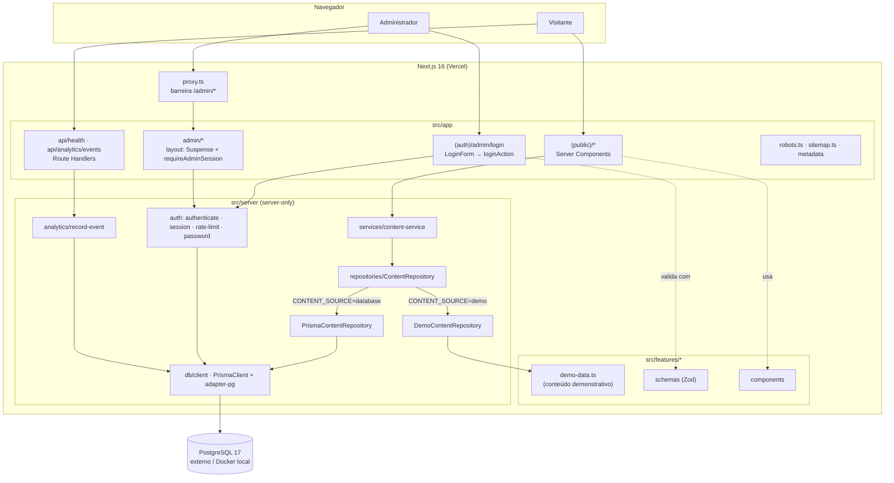

# ARCHITECTURE — DevPath

> Documento técnico normativo (nível 2). Descreve a arquitetura **como está** no bootstrap e marca o que é Planejado. Decisões e alternativas em [`DECISIONS.md`](DECISIONS.md).

## Visão geral

O DevPath é **uma única aplicação Next.js 16** (App Router) que atende três públicos com a mesma base de código:

| Superfície | Rotas | Autenticação | Renderização |
|---|---|---|---|
| Site público | `/`, `/carreiras`, `/roadmaps`, `/cursos`, `/projetos`, `/mercado`, `/lendas-da-ti`, `/sobre` (+ detalhes por slug) | Nenhuma | Server Components com shell estático (Cache Components) |
| Painel administrativo | `/admin/login`, `/admin/*` | Sessão de administrador (cookie httpOnly) | Server Components + Server Actions; `noindex` |
| API HTTP | `/api/health`, `/api/analytics/events` | Nenhuma (endpoints públicos com validação e limite) | Route Handlers |

Não existe backend separado: Server Components leem dados via camada de serviços `server-only`; Server Actions executam escrita autenticada; Route Handlers expõem o pouco que precisa ser HTTP puro (health, beacon de analytics). [ADR 0001](DECISIONS.md#0001--aplicação-única-nextjs-sem-backend-separado).



## Princípios

1. **Server Components por padrão.** Client Components só onde há interatividade: formulário de login, tracking de analytics, animações com Motion.
2. **Camadas com fronteira explícita.** Apresentação → aplicação → domínio/contratos → infraestrutura. A fronteira mais dura é `src/server/**`: só ali entra `import "server-only"` e o cliente Prisma (ESLint `no-restricted-imports` bloqueia `@/generated/*` fora).
3. **Fail-closed.** Sem `AUTH_SECRET` ou sem banco, o painel recusa login com mensagem clara; sem banco, o site público segue em modo demo e o analytics descarta sem erro.
4. **Uma fonte de verdade por vez.** `ContentRepository` escolhe demo **ou** banco por processo; o seed importa os mesmos `demo-data.ts`, logo nunca há dois conjuntos de conteúdo demo. [ADR 0005](DECISIONS.md#0005--conteúdo-demonstrativo-como-fonte-transitória-única).
5. **Cache Components.** Tudo que depende da requisição (`cookies()`, `headers()`, consulta ao banco) fica atrás de `<Suspense>`; o restante vira shell estático servido de imediato. [ADR 0006](DECISIONS.md#0006--cache-components-ligado-suspense-para-cookies-e-banco).
6. **Sem dados pessoais por padrão.** Nenhum cookie para visitantes; analytics sem identificadores e desligado até revisão.

## Camadas e responsabilidades

| Camada | Diretórios | Responsabilidade | Pode importar |
|---|---|---|---|
| **Apresentação** | `src/app/**`, `src/components/**`, `src/features/*/components/**` | Rotas, layouts, metadata, composição de UI. `page.tsx` só compõe. | `features`, `components`, `server/services` (apenas em Server Components), `config/site`, `lib`, `types` |
| **Aplicação** | `src/server/services/**`, `src/features/*/actions/**` | Casos de uso: compor leituras, orquestrar autenticação, validar entrada e chamar repositórios. | `server/repositories`, `server/auth`, `features/*/schemas`, `config/env` |
| **Domínio / contratos** | `src/types/**`, `src/features/*/schemas/**`, `src/features/*/demo-data.ts`, `src/server/auth/authenticate.ts` | DTOs públicos independentes do ORM, schemas Zod, regras puras testáveis sem I/O. | `zod`, `types` |
| **Infraestrutura** | `src/server/db/**`, `src/server/repositories/**`, `src/server/auth/{session,password,rate-limit,admin-repository}.ts`, `src/server/analytics/**` | Prisma, cookies, hashing, limitador, persistência. | `@/generated/prisma`, `jose`, `bcryptjs`, `next/headers` |
| **Configuração** | `src/config/site.ts` (público), `src/config/env.ts` (servidor, validado com Zod) | Constantes e variáveis de ambiente. | — |

Regras de dependência: setas só apontam para baixo. Infraestrutura nunca importa apresentação; `demo-data.ts` não importa nada de servidor (precisa rodar no seed via `tsx`).

## Separação público / admin

| Aspecto | Público `(public)` | Admin `admin/` + `(auth)/admin/login` |
|---|---|---|
| Layout | `src/app/(public)/layout.tsx`: `SkipLink`, faixa `.dp-mural-band` atrás do cabeçalho, `SiteHeader` (flutuante) (+ `MainNav`/`MobileNav`), `main#conteudo`, `SiteFooter`, `PageViewTracker`; `error.tsx` como limite de erro. | `src/app/admin/layout.tsx`: `<Suspense fallback={AdminShellSkeleton}>` → `AdminGate` (`requireAdminSession()`) → `AdminShell` com navegação administrativa e logout. O login fica no grupo `(auth)` para **não** herdar o layout protegido. |
| Metadata | `buildPageMetadata()` com canonical e Open Graph. | `adminMetadata` com `robots: noindex, nofollow`; `next.config.ts` adiciona `X-Robots-Tag` e `Cache-Control: no-store` em `/admin/:path*`. |
| Dados | `content-service` → repositório (demo ou banco), só `PUBLISHED`. | Planejado: repositórios administrativos que leem todos os estados e escrevem via Server Actions com `requireAdminSession()`. |
| Barreira | Nenhuma. | `src/proxy.ts` (matcher `/admin/:path*`) verifica o cookie `devpath_admin_session` com jose lendo `process.env.AUTH_SECRET` diretamente: sem sessão → redireciona ao login e apaga cookie inválido/expirado (evita loop); em `/admin/login` com sessão válida → redireciona ao dashboard. A verificação **que vale** é a do servidor (`requireAdminSession()`), porque proxy pode ser contornado por erro de matcher. |
| Indexação | `robots.ts` permite tudo exceto `/admin` e `/api`; `sitemap.ts` lista rotas estáticas e carreiras publicadas. | Bloqueado em `robots.ts`, metadata e cabeçalho. |

## Fluxos de dados

### Leitura pública

1. `page.tsx` (Server Component) chama `listCareers()` de `src/server/services/content-service.ts` dentro de um componente assíncrono envolto em `<Suspense fallback={<Skeleton/>}>`.
2. O serviço delega a `getContentRepository()`, resolvido uma vez por processo por `resolveContentSource({ CONTENT_SOURCE, DATABASE_URL })` (função pura em `src/server/repositories/content-source.ts`, testada em unidade):
   - `CONTENT_SOURCE=demo` → `DemoContentRepository` (arquivos `demo-data.ts`, filtra `status === "PUBLISHED"`, ordena).
   - `CONTENT_SOURCE=database` → `PrismaContentRepository` (`where: { status: PUBLISHED }`).
   - `CONTENT_SOURCE` vazio → banco se houver `DATABASE_URL`, senão demo. Pedir `database` sem URL lança `ContentSourceConfigurationError` (falha alta, nunca silenciosa).
3. O repositório devolve DTOs de `src/types/content.ts`; a página nunca vê tipos do Prisma.

### Login do administrador

1. `LoginForm` (client) valida com `loginSchema` (Zod) via React Hook Form e submete à Server Action `loginAction`.
2. `loginAction` revalida com o mesmo schema, extrai a chave do cliente dos cabeçalhos (`x-forwarded-for`) e chama `authenticateAdmin()` com dependências reais injetadas.
3. `authenticateAdmin()` aplica, nesta ordem: `AUTH_SECRET` configurado? → banco configurado? → limite de tentativas → busca por e-mail → `bcrypt.compare` (sempre executado, contra hash fictício quando o e-mail não existe, para igualar o tempo) → conta ativa?
4. Sucesso: `createAdminSession()` assina JWT HS256 (emissor `devpath`, audiência `devpath-admin`, TTL `AUTH_SESSION_TTL_HOURS`) e grava cookie httpOnly; `redirect("/admin/dashboard")`.
5. Falha: estado de formulário com mensagem; credencial inválida é sempre "E-mail ou senha inválidos".

### Evento de analytics

1. `PageViewTracker` (layout público) ou `TrackedLink` chamam `trackEvent()`; no-op se `NEXT_PUBLIC_ANALYTICS_ENABLED !== "true"`.
2. `trackEvent()` valida com `analyticsEventSchema` (strict) e envia por `sendBeacon` para `POST /api/analytics/events`.
3. O handler revalida, aplica `analyticsRateLimiter`, chama `recordAnalyticsEvent()`: grava em `AnalyticsEvent` se há banco; senão descarta. Responde `202` em ambos os casos.
4. Agregação diária em `AnalyticsDailyAggregate` e leitura no dashboard: **Planejado**.

## Estrutura de diretórios

```text
src/
├── app/
│   ├── layout.tsx                 # html lang="pt-BR", fontes (Inter, Permanent Marker), metadata base
│   ├── globals.css                # tokens do Design System + shadcn
│   ├── not-found.tsx · robots.ts · sitemap.ts
│   ├── (public)/
│   │   ├── layout.tsx             # SkipLink, faixa do mural, SiteHeader (flutuante), SiteFooter, PageViewTracker
│   │   ├── error.tsx              # limite de erro das páginas públicas (sem detalhes internos)
│   │   ├── page.tsx               # início (provisório, identificado como base de desenvolvimento)
│   │   ├── carreiras/ page.tsx · [slug]/page.tsx
│   │   ├── roadmaps/  page.tsx · [slug]/page.tsx
│   │   ├── cursos/ · projetos/ · mercado/ · sobre/  page.tsx
│   │   └── lendas-da-ti/ page.tsx · [slug]/page.tsx
│   ├── (auth)/admin/login/        # layout.tsx (noindex) + page.tsx (LoginForm)
│   ├── admin/
│   │   ├── layout.tsx             # Suspense + requireAdminSession + AdminShell
│   │   ├── page.tsx               # redirect → /admin/dashboard
│   │   └── dashboard/ carreiras/ roadmaps/ cursos/ projetos/ conteudos/ analytics/  page.tsx
│   └── api/
│       ├── health/route.ts
│       └── analytics/events/route.ts
├── proxy.ts                       # matcher /admin/:path*, exceto /admin/login
├── components/
│   ├── ui/                        # shadcn (não editar à mão além do necessário)
│   ├── design-system/             # PaperCard, StickyNote, Tape, Doodle, CharacterSticker, RetroTerminal, SectionHeading
│   ├── layout/                    # SiteHeader, SiteFooter, MainNav, MobileNav (Sheet), AdminShell, SkipLink
│   ├── branding/                  # Logo (wordmark em texto + seta SVG; o PNG entregue não tem canal alfa)
│   ├── feedback/                  # DevNotice, EmptyState, StatusBadge
│   └── motion/                    # Reveal (motion/react, respeita useReducedMotion)
├── features/
│   ├── careers/    demo-data.ts · components/career-card.tsx
│   ├── roadmaps/   demo-data.ts · components/roadmap-step.tsx
│   ├── courses/ projects/ market/ legends/   demo-data.ts
│   ├── content/    demo-types.ts  # DemoRecord<T> e a regra do conteúdo demonstrativo
│   ├── analytics/  schemas.ts · track.ts · components/{page-view-tracker,tracked-link}.tsx
│   ├── home/                 # hero da página inicial (Hero, HeroWordmark, HeroCharacter, HeroCareers, HeroCareerCard)
│   └── admin/      schemas/login.ts · actions/login.ts · components/{login-form,admin-page-header,planned-section}.tsx
├── server/
│   ├── db/client.ts               # getPrismaClient(): singleton com PrismaPg; lança DatabaseNotConfiguredError
│   ├── repositories/              # content-source.ts (resolveContentSource, puro), content-repository.ts (interface + seleção), demo-content-repository.ts, prisma-content-repository.ts
│   ├── services/content-service.ts
│   ├── auth/                      # session-token.ts (puro, usado pelo proxy), session.ts (cookies), authenticate.ts (puro), password.ts, rate-limit.ts, admin-repository.ts, require-admin.ts
│   └── analytics/record-event.ts
├── config/  site.ts · env.ts
├── lib/     utils.ts (cn) · slug.ts · seo.ts
├── types/   content.ts            # (src/hooks só será criada quando houver hook compartilhado)
└── generated/prisma/              # saída do `prisma generate` — ignorada no git
```

Regras: pasta nova só com arquivo dentro e finalidade clara; feature nova = diretório em `src/features/<dominio>` com `demo-data.ts` (se houver conteúdo), `schemas/`, `components/`, `actions/` conforme a necessidade.

## Padrões transversais

| Tema | Padrão |
|---|---|
| Variáveis de ambiente | `src/config/env.ts` valida com Zod no carregamento do módulo e expõe `serverEnv`, `isDatabaseConfigured`, `isAuthConfigured`. Nunca ler `process.env` espalhado no servidor. |
| Erros | Classes nomeadas (`DatabaseNotConfiguredError`, `ContentSourceConfigurationError`); mensagens em pt-BR apontando para o doc que resolve. Route Handlers respondem JSON `{ erro, detalhes? }` ([`API.md`](API.md#formato-de-erro)). |
| Slugs | `src/lib/slug.ts` (`slugify`, `isValidSlug`, `findDuplicateSlugs`); únicos por tabela; URL semântica `/carreiras/<slug>`. |
| Metadata | `buildPageMetadata({ title, description, path })` em toda página pública; `adminMetadata` no admin. |
| Fontes | `next/font/google` com variáveis CSS `--font-inter` e `--font-permanent-marker`. |
| Animação | `motion/react` só em Client Components pequenos (`src/components/motion/reveal.tsx`), sempre respeitando `useReducedMotion`; CSS global zera animações em `prefers-reduced-motion`. |
| Testes | Regras puras recebem dependências por parâmetro (`authenticateAdmin`, `createMemoryRateLimiter`), logo testam sem banco. |

## Decisões de arquitetura relacionadas

| ADR | Tema |
|---|---|
| [0001](DECISIONS.md#0001--aplicação-única-nextjs-sem-backend-separado) | Aplicação única Next.js |
| [0003](DECISIONS.md#0003--prisma-7-fixado-em-7101-com-driver-adapter-pg) | Prisma 7 + driver adapter |
| [0004](DECISIONS.md#0004--autenticação-própria-do-painel-jose--bcrypt--cookie-httponly) | Autenticação própria do painel |
| [0005](DECISIONS.md#0005--conteúdo-demonstrativo-como-fonte-transitória-única) | Conteúdo demonstrativo e transição |
| [0006](DECISIONS.md#0006--cache-components-ligado-suspense-para-cookies-e-banco) | Cache Components |
| [0007](DECISIONS.md#0007--analytics-first-party-sem-identificadores-desligado-por-padrão) | Analytics |
| [0014](DECISIONS.md#0014--estrutura-modular-por-features-com-camada-server-only) | Estrutura modular |

## Comportamentos conhecidos

| Comportamento | Causa | Consequência / mitigação |
|---|---|---|
| Rota dinâmica com slug **desconhecido** (`/carreiras/nao-existe`) responde `200` na **primeira** visita e `404` nas seguintes | `dynamicParams = false` é incompatível com `cacheComponents` (o build falha); o Next serve o App Shell e transmite o `not-found` em streaming; a ISR materializa o 404 nas visitas seguintes | O visitante vê a página 404 correta nos dois casos; só o status HTTP da primeira resposta difere. Rotas estáticas inexistentes (`/nao-existe`) respondem `404` sempre. Registrado em [`CHECKLIST-E2E-STAGING.md`](CHECKLIST-E2E-STAGING.md) (PUB-07). |
| `DevNotice` existe mas não está montado | O aviso de "base de desenvolvimento" foi retirado do layout público a pedido do mantenedor (30/out/2026); o estado do projeto fica em `/sobre`, no README e em MILESTONES. O componente permanece em `src/components/feedback/` para uso futuro. |

## Pendências arquiteturais

| Item | Estado |
|---|---|
| Repositórios administrativos (leitura de todos os estados + escrita) | Planejado |
| Agregação de analytics (job ou Server Action agendada) | Planejado |
| Rate limit com armazenamento compartilhado | Planejado ([ADR 0008](DECISIONS.md#0008--rate-limit-em-memória-como-medida-provisória)) |
| CSP estrita com nonces | Pendente ([ADR 0009](DECISIONS.md#0009--cabeçalhos-de-segurança-no-nextconfig-csp-estrita-pendente)) |
| Provedor de imagens remotas (se houver) em `images.remotePatterns` | Pendente de decisão |
| `instrumentation.ts` / observabilidade | Pendente de decisão |
