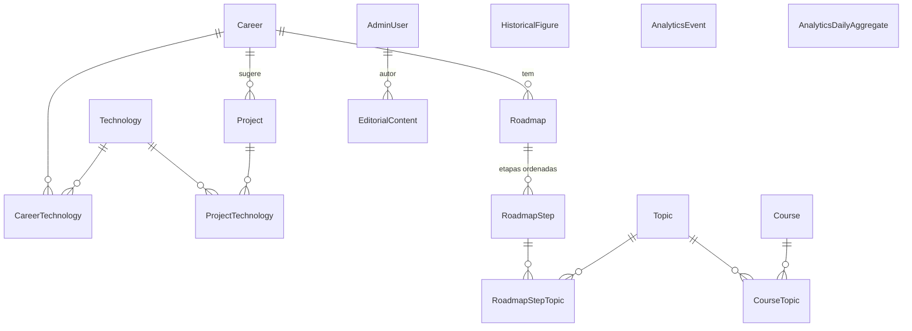

# DATABASE — DevPath

> Modelo de dados, Prisma, migrations e seeds. Nível 2 da hierarquia documental. Fonte da verdade do schema: [`prisma/schema.prisma`](../prisma/schema.prisma). Este documento explica o porquê; o arquivo diz o quê.

## SGBD e acesso

| Item | Valor |
|---|---|
| Banco | PostgreSQL 17 (local: `postgres:17-alpine` via `docker-compose.yml`; produção: provedor externo a contratar — [ADR 0013](DECISIONS.md#0013--vercel-como-destino-e-postgresql-externo)) |
| ORM | Prisma **7.10.1** (fixado; [ADR 0003](DECISIONS.md#0003--prisma-7-fixado-em-7101-com-driver-adapter-pg)) |
| Generator | `prisma-client`, saída `src/generated/prisma` (ignorada no git; gerada por `pnpm db:generate` e no `build`) |
| Driver | `@prisma/adapter-pg` sobre `pg` — obrigatório no Prisma 7 |
| Configuração | `prisma.config.ts` (`schema`, `migrations.path`, `migrations.seed`, `datasource.url` lida de `DATABASE_URL`) |
| Cliente | `src/server/db/client.ts` → `getPrismaClient()`: singleton por processo; lança `DatabaseNotConfiguredError` sem `DATABASE_URL` |
| Quem pode importar | Apenas `src/server/**` e `prisma/**` (ESLint `no-restricted-imports`) |

`prisma generate` e `prisma validate` **não** precisam de banco; `migrate`, `db push`, `studio` e `seed` precisam.

## Estado atual

| Item | Estado |
|---|---|
| Schema desenhado e validado (`pnpm db:validate`) | Implementado |
| Cliente gerado (`pnpm db:generate`) | Implementado |
| Migrations em `prisma/migrations/` | **Pendente** — não geradas (exigem banco; Docker indisponível no bootstrap). O primeiro `pnpm db:migrate` as cria. |
| Seed (`prisma/seed.ts`) | Implementado; não executado (sem banco) |
| Repositório de leitura pública (`PrismaContentRepository`) | Implementado; não exercitado contra banco real |
| Repositórios administrativos (escrita) | Planejado |

## Princípios do modelo

1. **Slug único por tabela** (`@unique`) em todo conteúdo público: é a chave das URLs.
2. **Estado de publicação único** (`PublicationStatus`: `DRAFT`, `PUBLISHED`, `ARCHIVED`) em todo conteúdo editorial, com `publishedAt` preenchido na primeira publicação. O site só lê `PUBLISHED`.
3. **Timestamps** `createdAt`/`updatedAt` em toda tabela com ciclo de vida.
4. **Integridade referencial explícita** com `onDelete` escolhido por caso (abaixo), nunca o padrão implícito.
5. **Sem dados pessoais de visitantes.** As únicas pessoas no banco são administradores.
6. **DTO ≠ modelo.** O site consome `src/types/content.ts`; o Prisma não vaza para componentes.

## Modelos



### Conteúdo educacional

| Modelo | Papel | Campos de destaque | Relações / `onDelete` |
|---|---|---|---|
| `Career` | Carreira (ex.: front-end) | `slug`, `title`, `shortDescription`, `description`, `icon` (nome Lucide), `accent` (token do DS), `order`, `status`, `publishedAt` | → `Roadmap[]`, `Project[]`, `CareerTechnology[]` |
| `Roadmap` | Trilha de uma carreira | `slug`, `level` (`SkillLevel`), `order`, `status` | `careerId` **Restrict** (não apagar carreira com roadmap) |
| `RoadmapStep` | Etapa ordenada | `order`, `title`, `description`; `@@unique([roadmapId, order])` | `roadmapId` **Cascade** |
| `Topic` | Tópico de estudo — **taxonomia compartilhada** entre roadmaps (o mesmo "http-basico" aparece em etapas de trilhas diferentes) | `slug` único, `title`, `description?`; sem vínculo direto com etapa | ↔ `RoadmapStep` via `RoadmapStepTopic` (`order` por etapa; **Cascade** dos dois lados); ↔ `Course` via `CourseTopic` |
| `Course` | Recurso gratuito / documentação | `provider`, `url`, `language` (BCP 47), `level`, `isFree` (default `true`), `isOfficialDocs`, `durationMinutes?`, `status` | ↔ `Topic` via `CourseTopic` (Cascade dos dois lados) |
| `Project` | Projeto prático | `level`, `estimatedHours?`, `acceptance` (Markdown), `careerId?`, `status` | `careerId` **SetNull**; ↔ `Technology` via `ProjectTechnology` |
| `Technology` | Catálogo de tecnologias | `category` (`TechnologyCategory`), `website?` — **sem** estado de publicação (é apoio) | ↔ `Career` via `CareerTechnology` (`importance` 1–3) |
| `HistoricalFigure` | "Lendas da TI" | `bornYear?`, `diedYear?`, `summary`, `biography`, `contributions String[]`, `imagePath?`, `status` | — |
| `EditorialContent` | Artigos, guias, páginas | `kind` (`ARTICLE`, `GUIDE`, `PAGE`), `excerpt?`, `body`, `status`, `authorId?` | `authorId` **SetNull** |

Tabelas de junção com chave composta: `RoadmapStepTopic (stepId, topicId, order)` com índice `(stepId, order)`, `CourseTopic (courseId, topicId)`, `CareerTechnology (careerId, technologyId, importance)`, `ProjectTechnology (projectId, technologyId)`. O tópico é o elo entre roadmap e curso: etapa → tópico → cursos que o cobrem.

### Administração

| Modelo | Campos | Regras |
|---|---|---|
| `AdminUser` | `email` único, `name`, `passwordHash` (bcrypt, custo 12), `role` (`OWNER`, `EDITOR`), `isActive`, `lastLoginAt?` | Senha nunca em texto puro; conta inativa não autentica; `OWNER` é o único que gerencia administradores (Planejado). |

### Analytics

| Modelo | Campos | O que **não** tem |
|---|---|---|
| `AnalyticsEvent` | `type` (`AnalyticsEventType`), `path`, `targetSlug?`, `externalHost?`, `occurredAt`; índices `(type, occurredAt)` e `(path, occurredAt)` | IP, user-agent, cookie, identificador de sessão/visitante, referrer completo, query string |
| `AnalyticsDailyAggregate` | `date` (`@db.Date`), `type`, `path`, `count`; `@@unique([date, type, path])` | — |

Retenção dos eventos brutos: **Pendente de decisão** (proposta: agregar diariamente e apagar eventos com mais de 90 dias — [`INTEGRATION.md`](INTEGRATION.md#analytics)).

## Enums

| Enum | Valores |
|---|---|
| `PublicationStatus` | `DRAFT`, `PUBLISHED`, `ARCHIVED` |
| `SkillLevel` | `BEGINNER`, `INTERMEDIATE`, `ADVANCED` |
| `TechnologyCategory` | `LANGUAGE`, `FRAMEWORK`, `LIBRARY`, `DATABASE`, `TOOL`, `PLATFORM`, `CONCEPT` |
| `EditorialKind` | `ARTICLE`, `GUIDE`, `PAGE` |
| `AdminRole` | `OWNER`, `EDITOR` |
| `AnalyticsEventType` | `PAGE_VIEW`, `ROADMAP_CLICK`, `COURSE_CLICK`, `PROJECT_CLICK`, `CAREER_NAVIGATION`, `EXTERNAL_LINK_CLICK` |

Os tipos de `src/types/content.ts` repetem os mesmos literais para que o repositório Prisma e o demo sejam intercambiáveis sem conversão.

## Regras encarnadas no schema

| Regra | Como |
|---|---|
| Slug único | `@unique` em `Career`, `Roadmap`, `Topic`, `Course`, `Project`, `Technology`, `HistoricalFigure`, `EditorialContent` |
| Etapas sem ordem repetida | `@@unique([roadmapId, order])` |
| Carreira não some com roadmap pendurado | `onDelete: Restrict` em `Roadmap.career` |
| Apagar roadmap limpa etapas | `onDelete: Cascade` em `RoadmapStep.roadmap` |
| Projeto sobrevive à remoção da carreira; tópico é compartilhado e só perde o vínculo com a etapa apagada | `onDelete: SetNull` em `Project.career`; `Cascade` em `RoadmapStepTopic` |
| Consultas do site rápidas | Índices `(status, order)`, `(careerId, status, order)`, `(stepId, order)`, `(status, level)`, `(kind, status)` |
| Um agregado por dia/tipo/caminho | `@@unique([date, type, path])` |

## Regras que só o código impõe (e onde)

| Regra | Onde |
|---|---|
| Site lê só `PUBLISHED` | `PrismaContentRepository` e `DemoContentRepository` |
| `publishedAt` preenchido na primeira publicação | Seed preenche para registros `PUBLISHED`; nas Server Actions de conteúdo: Planejado |
| Slug gerado de título e validado | `src/lib/slug.ts` (`slugify`, `isValidSlug`) |
| Senha com bcrypt custo 12 | `src/server/auth/password.ts` |
| Eventos de analytics validados e sem campos extras | `analyticsEventSchema` (`strict`) |
| Curso listado precisa ser gratuito | Regra editorial; `isFree` default `true` serve de auditoria. Validação na action: Planejado |

## Migrations

Fluxo (Prisma 7):

```bash
pnpm db:up                 # Postgres local
pnpm db:migrate            # prisma migrate dev → cria prisma/migrations/<timestamp>_init e aplica
pnpm db:migrate:deploy     # produção/CI: aplica migrations pendentes, nunca gera
```

Regras:

- Migration é gerada **só** por `migrate dev` em ambiente local e revisada no PR (SQL legível).
- Produção recebe migrations por `prisma migrate deploy` em etapa separada do build ([`DEPLOY.md`](DEPLOY.md#migrations)); o `build` da Vercel só roda `prisma generate`.
- `prisma migrate reset` e `db push` só no banco local pessoal.
- Migration destrutiva (drop de coluna/tabela com dados) exige ADR ou aval explícito e plano de rollback.
- Primeira migration: **Pendente** (será `init`, gerada a partir do schema atual).

## Seeds

`prisma/seed.ts` (executado por `pnpm db:seed` ou `prisma db seed`, via `tsx`):

| O que faz | Condição |
|---|---|
| Importa `src/features/*/demo-data.ts` e faz `upsert` por slug de tecnologias, carreiras (+ `CareerTechnology`), roadmaps/etapas/tópicos (+ `RoadmapStepTopic`), cursos (+ `CourseTopic`), projetos (+ `ProjectTechnology`) e figuras históricas, **preservando o `status` de cada registro demo** (rascunhos continuam rascunhos) e preenchendo `publishedAt` nos `PUBLISHED` | `SEED_DEMO_CONTENT=true` (padrão no `.env.example`; qualquer outro valor pula o conteúdo) |
| Cria/atualiza um `AdminUser` `OWNER` (nome "Administrador") com senha em bcrypt custo 12; recusa senha com menos de 12 caracteres | `SEED_ADMIN_EMAIL` **e** `SEED_ADMIN_PASSWORD` preenchidos **e** `NODE_ENV !== "production"` |
| Aborta com erro claro | `NODE_ENV === "production"` ou sem `DATABASE_URL` |

Não há administrador padrão, senha conhecida nem conteúdo marcado como real. O seed é idempotente (`upsert`), logo pode rodar várias vezes.

## Transição do conteúdo demonstrativo para o banco

Regra: **não existem duas fontes de verdade permanentes** ([ADR 0005](DECISIONS.md#0005--conteúdo-demonstrativo-como-fonte-transitória-única)).

| Fase | Fonte do site | Papel do `demo-data.ts` |
|---|---|---|
| Bootstrap (agora) | `CONTENT_SOURCE=demo` | Única fonte, marcada como demonstrativa |
| Banco configurado em dev | `CONTENT_SOURCE=database` após `db:migrate` + `db:seed` | Insumo do seed; serve para testes unitários |
| Produção com curadoria | `database` | Só fixture de desenvolvimento/testes; o conteúdo real nasce e vive no painel |

Quando a curadoria real existir, os registros demo podem ser arquivados pelo painel ou removidos por migration de dados dedicada; o arquivo demo permanece como fixture de teste.

## Pendências conhecidas

| Item | Estado |
|---|---|
| Gerar e revisar a migration inicial | Pendente (precisa de banco) |
| Decidir retenção de `AnalyticsEvent` e job de agregação | Pendente |
| Provedor do PostgreSQL em produção (pooling, região, backups) | Pendente ([`INTEGRATION.md`](INTEGRATION.md#banco-de-dados-externo)) |
| Tabela para rate limit compartilhado (se a opção for banco em vez de KV) | Planejado ([ADR 0008](DECISIONS.md#0008--rate-limit-em-memória-como-medida-provisória)) |
| Busca textual (índice GIN/`unaccent`) | Fora do MVP |
