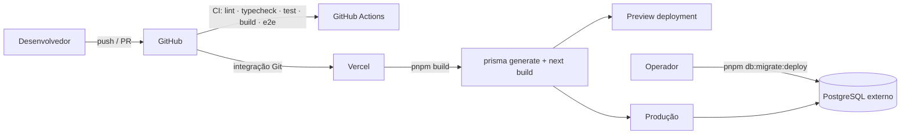

# DEPLOY — DevPath

> Estratégia de publicação na Vercel, variáveis, migrations, checklist de produção e rollback. Nível 4 da hierarquia documental. **Nada aqui foi executado**: não existe projeto na Vercel nem banco de produção. A seção [Executado vs planejado](#executado-vs-planejado) é a fonte da verdade do estado.

## Visão geral



Princípios:

1. **CI não faz deploy.** O workflow só valida; a publicação vem da integração Git da Vercel (ou de `vercel deploy` manual, quando decidido).
2. **Migrations fora do build.** O build da Vercel roda `prisma generate`; `prisma migrate deploy` é uma etapa explícita, executada antes de promover um deploy que dependa do schema novo.
3. **Segredos só no painel da Vercel.** Nunca em `vercel.json`, código ou CI.
4. **Produção funciona sem banco?** Não para o painel, mas o site público pode subir em `CONTENT_SOURCE=demo` como contingência, desde que isso esteja explícito na interface e no `CHANGELOG.md`.

## Ambientes

| Ambiente | Onde | Banco | `CONTENT_SOURCE` | `AUTH_SECRET` | Estado |
|---|---|---|---|---|---|
| Local | máquina do dev | Docker (`pnpm db:up`) ou nenhum | `demo` ou `database` | opcional | Implementado |
| CI | GitHub Actions | nenhum (`DATABASE_URL` fictícia só para `prisma generate`) | `demo` | ausente | Implementado |
| Preview | Vercel (por PR) | banco de preview **separado** ou nenhum | `demo` (padrão) | ausente (painel bloqueado) ou segredo de preview | Planejado |
| Produção | Vercel | PostgreSQL externo | `database` | obrigatório | Planejado |

## Pré-requisitos externos

| Item | Responsável | Estado |
|---|---|---|
| Conta/organização na Vercel e projeto ligado ao repositório `Victorkaue333/dev-path` | Mantenedor | Pendente |
| Provedor de PostgreSQL com pooling e TLS ([`INTEGRATION.md`](INTEGRATION.md#banco-de-dados-externo)) | Mantenedor | Pendente |
| Domínio público e `NEXT_PUBLIC_SITE_URL` definido | Mantenedor | Pendente |
| `AUTH_SECRET` gerado (`openssl rand -base64 32`) e guardado só no painel da Vercel | Mantenedor | Pendente |
| Primeiro administrador criado (procedimento abaixo) | Mantenedor | Pendente |
| Decisão de licença ([ADR 0011](DECISIONS.md#0011--licença-do-projeto-decisão-pendente)) antes de divulgar o repositório | Mantenedor | Pendente |

## Configuração do projeto na Vercel (planejado)

| Campo | Valor |
|---|---|
| Framework preset | Next.js |
| Build command | `pnpm build` |
| Install command | `pnpm install --frozen-lockfile` |
| Output | padrão do Next.js |
| Node.js version | 24.x |
| Root directory | `/` |
| Região das funções | a mesma do banco |

Não é necessário `vercel.json`: cabeçalhos de segurança já estão em `next.config.ts`.

## Variáveis de ambiente por ambiente

| Variável | Produção | Preview | Observação |
|---|---|---|---|
| `NEXT_PUBLIC_SITE_URL` | domínio público (`https://…`) | URL do preview ou domínio público | Afeta canonical, OG e sitemap |
| `NEXT_PUBLIC_ANALYTICS_ENABLED` | `false` até revisão de privacidade | `false` | Ver [`INTEGRATION.md`](INTEGRATION.md#analytics) |
| `CONTENT_SOURCE` | `database` | `demo` (ou `database` com banco de preview) | `database` sem `DATABASE_URL` derruba o build/execução de propósito |
| `DATABASE_URL` | URL do provedor com `sslmode=require` | banco de preview ou ausente | Nunca a de produção em preview |
| `AUTH_SECRET` | segredo forte (≥ 32 chars) | ausente ou segredo próprio | Trocar invalida todas as sessões |
| `AUTH_SESSION_TTL_HOURS` | `8` | `8` | — |
| `SEED_*` | **nunca definir** | nunca | O seed aborta com `NODE_ENV=production` |

Definições completas: [`ENVIRONMENT.md`](ENVIRONMENT.md).

## Migrations

```bash
# na máquina do operador, apontando para o banco de produção (nunca pela Vercel no build)
DATABASE_URL="<url de produção>" pnpm db:migrate:deploy
```

Regras:

1. `migrate deploy` roda **antes** de promover o deploy que precisa do schema novo; em mudanças compatíveis (coluna nova opcional), pode rodar antes ou depois.
2. Mudança incompatível (renomear/remover coluna) é feita em dois deploys: expandir → migrar dados → contrair.
3. Nunca `migrate dev`, `migrate reset` ou `db push` contra produção.
4. Backup (ou snapshot do provedor) antes de qualquer migration que altere tabela com dados.
5. Primeira migration ainda não existe ([`DATABASE.md`](DATABASE.md#migrations)).

## Primeiro administrador em produção

O seed é bloqueado em produção por desenho. Opções (decisão Pendente, registrar em ADR quando escolhida):

| Opção | Como | Prós / contras |
|---|---|---|
| A. Seed contra o banco de produção a partir da máquina do operador com `NODE_ENV=development` | `SEED_ADMIN_EMAIL/PASSWORD` só no terminal do operador, `SEED_DEMO_CONTENT=false` | Simples; exige disciplina para não popular conteúdo demo |
| B. Script dedicado `scripts/create-admin.ts` | Cria só o admin, pede senha interativamente | Mais seguro; Planejado |
| C. Tela de gestão de administradores no painel | Exige um primeiro admin de qualquer forma | Complementar, não substitui A/B |

Em todos os casos: senha forte, troca após o primeiro login (troca obrigatória é Planejada), e-mail institucional.

## Checklist de produção

Marcar cada item com data e responsável quando executado. Hoje tudo está **Pendente**.

- [ ] Projeto Vercel criado e ligado ao repositório.
- [ ] Banco criado, TLS ativo, pooling configurado, backup habilitado.
- [ ] Variáveis de produção cadastradas; nenhuma `SEED_*`.
- [ ] `pnpm db:migrate:deploy` executado e `_prisma_migrations` conferida.
- [ ] Primeiro administrador criado; login testado; `/admin` sem sessão redireciona para `/admin/login`.
- [ ] `GET /api/health` responde `200` com `contentSource: "database"` e `database: "configured"`.
- [ ] `robots.txt` bloqueia `/admin` e `/api`; `sitemap.xml` lista só rotas públicas; páginas admin com `X-Robots-Tag: noindex`.
- [ ] Cabeçalhos de segurança presentes (verificar com `curl -I`).
- [ ] `NEXT_PUBLIC_ANALYTICS_ENABLED=false` até a revisão de privacidade.
- [ ] Lighthouse/axe nas páginas públicas dentro das metas ([`PRD.md`](PRD.md#requisitos-não-funcionais)).
- [ ] Conteúdo demonstrativo arquivado ou substituído por conteúdo curado (`DevNotice` já removido do layout em 30/out/2026) (hoje ele aparece em todos os ambientes, por desenho, até existir conteúdo real).
- [ ] `CHANGELOG.md` com a versão publicada; tag no Git.

## Rollback

| Situação | Ação |
|---|---|
| Deploy com bug sem mudança de schema | "Promote" do deploy anterior no painel da Vercel (instantâneo) |
| Deploy após migration compatível | Rollback do deploy; schema novo não quebra a versão anterior |
| Deploy após migration incompatível | Não há rollback automático do banco: aplicar migration de reversão escrita previamente ou restaurar backup; por isso a regra expandir/contrair |
| Vazamento de `AUTH_SECRET` | Trocar o segredo no painel e redeploy (invalida sessões); auditar `lastLoginAt` dos admins |
| Banco indisponível | Site público pode ser republicado em `CONTENT_SOURCE=demo` como contingência explícita; painel fica indisponível |

## Pipeline de CI (GitHub Actions)

Arquivo: `.github/workflows/ci.yml`. Dispara em `push` e `pull_request` para `main`.

| Job | Passos | Observação |
|---|---|---|
| `quality` | `pnpm install --frozen-lockfile` → `pnpm db:generate` → `pnpm db:validate` → `pnpm lint` → `pnpm format:check` → `pnpm typecheck` → `pnpm test` → `pnpm build` → upload de `.next` como artefato | Sem banco: `prisma generate`/`validate` não precisam de `DATABASE_URL`; `CONTENT_SOURCE=demo` e `NEXT_PUBLIC_SITE_URL=http://localhost:3000` no `env` do workflow |
| `e2e` (depende de `quality`) | install → `db:generate` → download do artefato `.next` → `playwright install --with-deps chromium` → `pnpm test:e2e` | Roda contra `pnpm start` (build de produção); relatório HTML enviado como artefato só em falha |

Sem job de deploy. `concurrency` cancela execuções antigas do mesmo ref. pnpm via `pnpm/action-setup` (versão do `packageManager`), Node do `.nvmrc`, `permissions: contents: read`.

## Executado vs planejado

Resultado da execução local dos mesmos comandos do CI: [README › Verificações executadas no bootstrap](../README.md#verificações-executadas-no-bootstrap). Nada foi executado em ambiente remoto.

| Item | Estado |
|---|---|
| Workflow de CI escrito | Implementado (não executado no GitHub ainda: não houve push) |
| Projeto na Vercel | **Não criado** |
| Deploy (preview ou produção) | **Não executado** |
| Banco de produção | **Não contratado** |
| Migrations aplicadas em qualquer ambiente | **Não** |
| Primeiro admin em produção | **Não** |
| Checklist de produção | **Pendente em todos os itens** |
| Rollback testado | **Não** |

## Decisões em aberto

- Provedor de PostgreSQL e necessidade de `DIRECT_URL`.
- Mecanismo para o primeiro administrador em produção (A/B/C acima).
- Domínio e política de preview deployments (banco próprio ou modo demo).
- Observabilidade (logs de função da Vercel bastam no início?).
