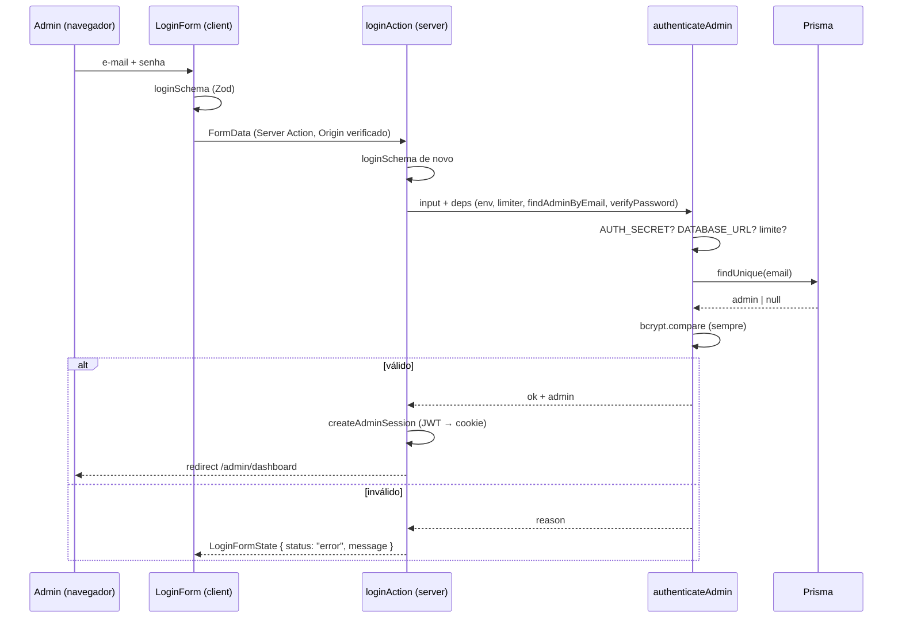
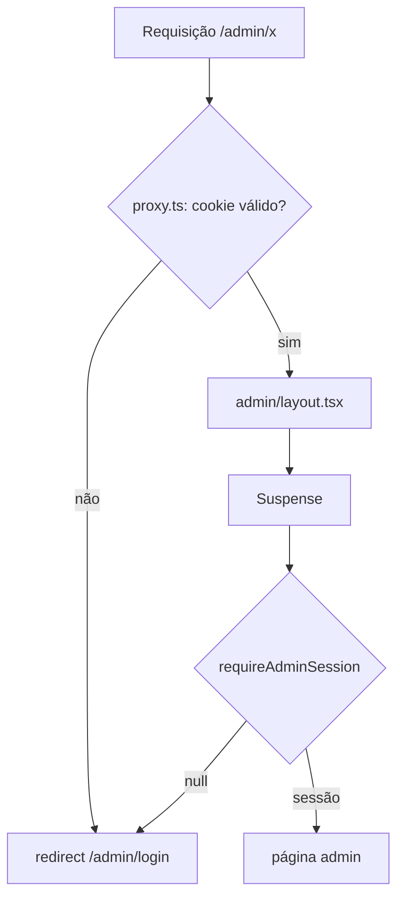

# Autenticação do painel administrativo — spec

> Criado: 29/out/2026 · Autor: bootstrap (agente), a ratificar pelo mantenedor · Status: **implementada** (spec retroativa: documenta o que a M0 entregou)
> Origem: briefing do bootstrap, seção 7 "Segurança do painel"
> Contrato: [SDD](../README.md) · Decisões relacionadas: [ADR 0004](../../DECISIONS.md#0004--autenticação-própria-do-painel-jose--bcrypt--cookie-httponly), [ADR 0008](../../DECISIONS.md#0008--rate-limit-em-memória-como-medida-provisória), [ADR 0012](../../DECISIONS.md#0012--sem-cadastro-público-em-qualquer-forma)
> Milestone: [M0](../../milestones/M0-bootstrap.md)

Administradores entram no painel com e-mail e senha; visitantes nunca têm login. Sem segredo ou banco configurados, o login explica o motivo e não entra. A sessão vive em cookie httpOnly e toda rota `/admin/*` é verificada no servidor.

---

## 0. Constituição

| Decisão fixa | Respeita? | Nota |
|---|---|---|
| Sem cadastro público (ADR 0012) | sim | Só `AdminUser`; nenhuma tela de registro |
| Sem número fictício | sim | Não se aplica à auth |
| Prisma só em `src/server/**` | sim | `admin-repository.ts` |
| Dados de requisição dentro de `<Suspense>` (ADR 0006) | sim | `admin/layout.tsx` envolve `requireAdminSession()` |
| Zod em toda entrada | sim | `loginSchema` no cliente e na action |
| pt-BR na interface | sim | Mensagens em `authFailureMessages` |
| Nenhum segredo no cliente | sim | `AUTH_SECRET` só em `src/config/env.ts` (`server-only`) e `proxy.ts` |

## 1. Contexto

- **FATO:** não existe provedor de identidade externo; o painel é a única superfície autenticada.
- **FATO:** o banco pode não existir em desenvolvimento (modo demo).
- **DECISÃO (ADR 0004):** auth própria com jose + bcrypt + cookie httpOnly.

## 2. Objetivos e não-objetivos

**Objetivos:** login seguro para poucos administradores; sessão com expiração; bloqueio de rotas administrativas no servidor; comportamento seguro quando a configuração está incompleta; proteção contra força bruta e enumeração.

**Não-objetivos (nesta versão):** MFA, recuperação de senha, troca obrigatória de senha, revogação individual de sessão, gestão de administradores pela interface, auditoria de ações.

### 2.1 Produto

- **Para quem:** administrador(a) de conteúdo.
- **Dor:** precisar de um painel sem expor o site a cadastro de visitantes nem depender de serviço externo.
- **Como se mede:** login funciona com banco configurado; sem banco, nenhuma entrada indevida. Métrica de uso não se aplica (sem analytics no painel).
- **Custo de não fazer:** nenhum CRUD seria possível com segurança.

## 3. Atores e permissões

| Ator | Pode |
|---|---|
| Visitante | Nada em `/admin/*` além de ver a tela de login |
| `EDITOR` | Entrar; futuramente CRUD de conteúdo |
| `OWNER` | Tudo do `EDITOR`; futuramente gerir administradores (`requireOwnerSession()`) |

## 4. Requisitos funcionais (EARS)

| ID | Requisito | Estado |
|---|---|---|
| FR-AUTH-01 | QUANDO um visitante acessa `/admin/*` sem sessão válida O SISTEMA DEVE redirecionar para `/admin/login` sem renderizar conteúdo administrativo | Implementado (`proxy.ts`, `requireAdminSession()`) |
| FR-AUTH-02 | QUANDO o formulário de login é enviado O SISTEMA DEVE validar e-mail e senha com `loginSchema` e devolver erros por campo | Implementado |
| FR-AUTH-03 | QUANDO `AUTH_SECRET` não está configurado O SISTEMA DEVE recusar o login com `auth_not_configured` antes de qualquer outra verificação | Implementado |
| FR-AUTH-04 | QUANDO `DATABASE_URL` não está configurada O SISTEMA DEVE recusar com `db_unavailable` | Implementado |
| FR-AUTH-05 | QUANDO a chave do cliente excede 5 tentativas em 15 minutos O SISTEMA DEVE recusar com `rate_limited` sem consultar o banco | Implementado (memória) |
| FR-AUTH-06 | QUANDO e-mail não existe, conta inativa ou senha incorreta O SISTEMA DEVE responder com a mesma mensagem genérica e executar a comparação bcrypt em todos os casos | Implementado |
| FR-AUTH-07 | QUANDO as credenciais são válidas O SISTEMA DEVE emitir JWT HS256 (`iss=devpath`, `aud=devpath-admin`, `exp` = TTL) em cookie `devpath_admin_session` httpOnly, SameSite=Lax, Secure em produção, atualizar `lastLoginAt`, zerar o limitador e redirecionar para `/admin/dashboard` | Implementado |
| FR-AUTH-08 | QUANDO o administrador aciona logout O SISTEMA DEVE apagar o cookie e redirecionar para o login | Implementado |
| FR-AUTH-09 | QUANDO o token está adulterado, expirado ou com claims incompletas O SISTEMA DEVE tratá-lo como ausente | Implementado (`verifySessionToken`) |
| FR-AUTH-10 | O SISTEMA NÃO DEVE conter administrador padrão, senha conhecida ou bypass; o primeiro admin nasce do seed com `SEED_ADMIN_*` (senha ≥ 12 caracteres) fora de produção | Implementado |
| FR-AUTH-11 | QUANDO um administrador autenticado acessa `/admin/login` O SISTEMA DEVE redirecioná-lo para `/admin/dashboard` | Implementado (`proxy.ts`) |

## 5. Requisitos não funcionais

| NFR | Limiar | Verificação |
|---|---|---|
| Hash de senha | bcrypt custo 12 | `password.ts`; teste unitário opcional (lento) |
| Resposta a credencial inválida | mensagem única; comparação sempre executada | teste de integração de `authenticateAdmin` |
| Cookie | `HttpOnly`, `SameSite=Lax`, `Secure` em produção, `Path=/` | e2e SEG-05 |
| Não indexação | `noindex` + `X-Robots-Tag` em `/admin/*` | e2e SEO-03 |
| Sem segredo no bundle | nenhum `AUTH_SECRET` em `NEXT_PUBLIC_*` | revisão |

## 6. Design

### 6.1 Sequência

### 6.2 Fluxo de acesso a `/admin/*`

### 6.3 Dados

Tabela tocada: `AdminUser` (`email` único, `passwordHash`, `role`, `isActive`, `lastLoginAt`). Sem migration além da inicial (Pendente). ER completo em [`../../DATABASE.md`](../../DATABASE.md#modelos).

### 6.4 Contrato

[`../../API.md`](../../API.md#server-actions): `loginAction(prevState, formData) → LoginFormState`; `logoutAction()`.

### 6.5 Arquivos

| Arquivo | Papel |
|---|---|
| `src/features/admin/schemas/login.ts` | `loginSchema`, `LoginFormState` |
| `src/features/admin/actions/login.ts` | `loginAction`, `logoutAction` |
| `src/features/admin/components/login-form.tsx` | Formulário (RHF + `useActionState`) |
| `src/server/auth/authenticate.ts` | Regra pura fail-closed |
| `src/server/auth/session-token.ts` | Assinar/verificar JWT (puro; usado pelo proxy) |
| `src/server/auth/session.ts` | Cookie (create/destroy/get) |
| `src/server/auth/password.ts` | bcrypt |
| `src/server/auth/rate-limit.ts` | Limitador em memória |
| `src/server/auth/admin-repository.ts` | `findAdminByEmail`, `touchLastLogin` |
| `src/server/auth/require-admin.ts` | `requireAdminSession`, `requireOwnerSession` |
| `src/proxy.ts` | Barreira `/admin/:path*`; em `/admin/login` redireciona quem já tem sessão; limpa cookie inválido |
| `src/app/(auth)/admin/login/*` | Página de login fora do layout protegido |
| `src/app/admin/layout.tsx` | Layout protegido |

## 7. Alternativas rejeitadas

Ver [ADR 0004](../../DECISIONS.md#0004--autenticação-própria-do-painel-jose--bcrypt--cookie-httponly): Auth.js, provedores externos, sessão opaca no banco.

## 8. Segurança

Coberta em [`../../Security-Guide.md`](../../Security-Guide.md#3-autenticação-do-painel). Riscos abertos: rate limit por instância, sem revogação individual, sem MFA.

## 9. Critérios de aceite

| # | Given / When / Then | Prova |
|---|---|---|
| 1 | Dado `AUTH_SECRET` ausente, quando o login é enviado, então a resposta é `auth_not_configured` e nenhuma consulta ao banco ocorre | `tests/unit/authenticate.test.ts` |
| 2 | Dado `AUTH_SECRET` e sem `DATABASE_URL`, então `db_unavailable` | `tests/unit/authenticate.test.ts` |
| 3 | Dadas 5 tentativas falhas na mesma chave, quando a 6ª chega, então `rate_limited` e `findAdminByEmail` não é chamado | `tests/unit/authenticate.test.ts`, `tests/unit/rate-limit.test.ts` |
| 4 | Dado e-mail inexistente, então `verifyPassword` é chamado e a razão é `invalid_credentials` | `tests/unit/authenticate.test.ts` |
| 5 | Dado admin inativo com senha correta, então `invalid_credentials` | `tests/unit/authenticate.test.ts` |
| 6 | Dado login válido, então `onSuccess` é chamado e o limitador é zerado | `tests/unit/authenticate.test.ts` |
| 7 | Dado token adulterado, expirado ou com claims inválidas, então `verifySessionToken` devolve `null` | `tests/unit/session-token.test.ts` |
| 8 | Dado `/admin/dashboard` sem cookie, então redirect para `/admin/login` | `tests/e2e/public-smoke.spec.ts` |
| 9 | Dado login sem `AUTH_SECRET`/`DATABASE_URL`, então alerta "não configurad…" e permanece em `/admin/login`; resposta com `X-Robots-Tag: noindex` | `tests/e2e/public-smoke.spec.ts` |

## 10. Pendências

MFA, recuperação de senha, troca obrigatória, revogação individual, gestão de administradores, rate limit compartilhado — todas registradas em [`../../Security-Guide.md`](../../Security-Guide.md#17-riscos-conhecidos-em-aberto).
