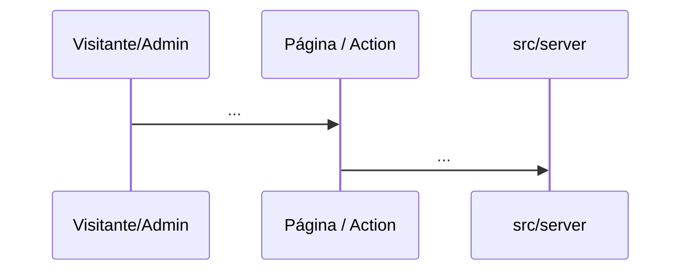

# <Nome da feature> — spec

> Criado: <DD/mmm/AAAA> · Autor: <nome> · Status: **proposta** | aprovada | implementada
> Origem: <pedido de quem, quando, frase original entre aspas quando houver; ou PRD RF-NN; ou mockup>
> Contrato: [SDD](../README.md) · Decisões relacionadas: <ADR-NNNN, ADR-NNNN>
> Milestone: <M<N> quando aprovada, senão "a definir">

<Um parágrafo: o que a feature faz e para quem, sem jargão de implementação. Se não couber em um parágrafo, divida a feature.>

---

## 0. Constituição (preencher ANTES de desenhar, reconferir DEPOIS)

| Decisão fixa | Respeita? | Nota |
|---|---|---|
| Sem cadastro, perfil, progresso em conta ou pagamento para visitantes (ADR 0012) | sim / **não** | |
| Nenhum número, estatística ou contador sem fonte real | sim / **não** | |
| Prisma só em `src/server/**`; componentes não acessam banco (ADR 0014) | sim / **não** | |
| `cookies()`/`headers()`/banco dentro de `<Suspense>`; `process.env` no escopo do módulo (ADR 0006) | sim / **não** | |
| Site público lê só `PUBLISHED` | sim / **não** | |
| Zod em toda entrada; mesmo schema no cliente e no servidor | sim / **não** | |
| Interface e mensagens em pt-BR; identificadores em inglês | sim / **não** | |
| Nenhum segredo no cliente; variáveis novas em `.env.example` + `ENVIRONMENT.md` | sim / **não** | |
| Dependência ou serviço novo → ADR | sim / **não** | |

Linha com **não** exige justificativa aqui ou aval do mantenedor.

## 1. Contexto

<FATOS sobre o código atual, com âncora (`arquivo`, função). DECISÕES já registradas que a feature herda.>

## 2. Objetivos e não-objetivos

**Objetivos:** <lista curta, verificável.>

**Não-objetivos:** <o que fica fora, de propósito.>

### 2.1 Produto

- **Para quem:** <persona do PRD>
- **Dor:** <o que acontece hoje sem a feature>
- **Hipótese:** <se fizermos X, acontece Y>
- **Como se mede:** <só com o que o analytics coleta ou pode coletar sem dado pessoal; "ainda não dá para medir" é resposta válida>
- **Custo de não fazer:** <...>

## 3. Atores e permissões

| Ator | Pode | Não pode |
|---|---|---|
| Visitante | | |
| `EDITOR` | | |
| `OWNER` | | |

## 4. Requisitos funcionais (EARS)

| ID | Requisito | Prioridade |
|---|---|---|
| FR-<FEAT>-01 | QUANDO <evento> O SISTEMA DEVE <comportamento> | obrigatório / desejável |
| FR-<FEAT>-02 | | |

## 5. Requisitos não funcionais

| NFR | Aplica? | Limiar | Verificação |
|---|---|---|---|
| Performance (shell estático, Suspense) | | | |
| Acessibilidade (teclado, contraste, reduced-motion) | | | |
| SEO (metadata, canonical, sitemap) | | | |
| Segurança (auth no servidor, validação, headers) | | | |
| Privacidade (nenhum dado pessoal novo) | | | |
| Responsividade (320–1440 px) | | | |

## 6. Design

### 6.1 Wireframe

<Texto por seção ou mermaid. `N/A` com motivo para feature sem tela.>

### 6.2 Sequência



### 6.3 Dados

<Tabelas/colunas novas ou reuso justificado; migration sim/não; índices; impacto em `DATABASE.md`.>

```mermaid
erDiagram
```

### 6.4 Fluxograma

```mermaid
flowchart TD
```

### 6.5 Contrato

<Server Actions / Route Handlers: entrada (Zod), saída, erros; impacto em `API.md`.>

### 6.6 Arquivos previstos

| Arquivo | Papel |
|---|---|
| | |

## 7. Alternativas rejeitadas

| Alternativa | Por que não |
|---|---|
| | |

## 8. Segurança e privacidade

<Ameaças específicas, controles, impacto em `Security-Guide.md`.>

## 9. Critérios de aceite

| # | Given / When / Then | Prova (teste ou evidência) |
|---|---|---|
| 1 | | |

## 10. Plano de testes

| Nível | O que cobre |
|---|---|
| Unitário | |
| Integração | |
| E2E | |

## 11. Rollout e rollback

<Flags, variáveis, migration expandir/contrair, como desfazer.>

## 12. Impacto em documentação

<Lista dos arquivos que mudam: `README`, `DECISIONS`, `DATABASE`, `API`, `DESIGN`, `ENVIRONMENT`, `CHANGELOG`.>

## 13. Pendências e perguntas

- `[PRECISA ESCLARECER: ...]`
